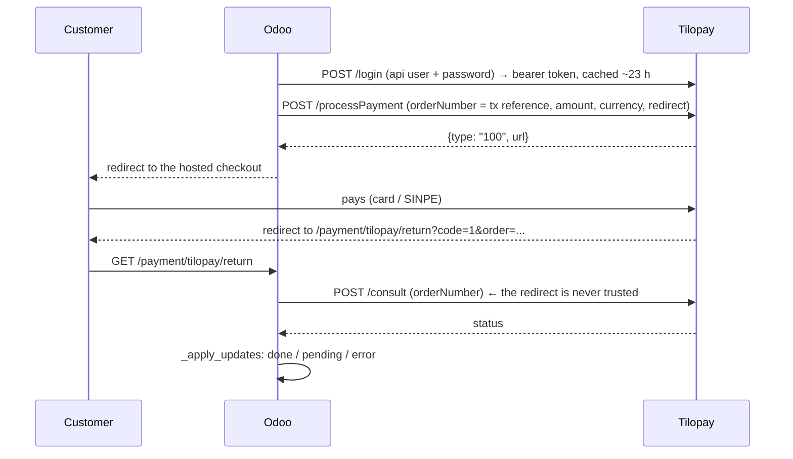

# Tilopay payment provider for Odoo 19 Community

[](https://github.com/victoreh24/odoo-payment-tilopay/actions/workflows/ci.yml)


[Tilopay](https://tilopay.com) is a Costa Rican payment gateway (cards and SINPE Móvil). This module
plugs its **hosted payment page** into Odoo 19's `payment` framework, so any flow that creates a
`payment.transaction` (eCommerce, invoices, a custom API) can charge through Tilopay.

Written for the booking backend of a tourism concierge
([odoo-concierge-api](https://github.com/victoreh24/odoo-concierge-api)), but it depends only on
Odoo's `payment` module and knows nothing about bookings.

## How it works



- **Never trust the redirect.** The return route only identifies the transaction; the outcome comes
  from Tilopay's `consult` endpoint. A forged `code=1` on the return URL does nothing.
- **Lost redirects are recovered.** An optional webhook (`/payment/tilopay/webhook`) and a cron every
  5 minutes reconcile transactions that are still pending two minutes after creation.
- **Unknown is not declined.** While the customer is still typing their card, `consult` may return
  nothing recognisable; the transaction stays `pending` and only becomes `error` on an explicit
  decline or after 2 hours. Amount and currency mismatches are rejected.
- **Credentials stay in Odoo.** API user, password and merchant key are `base.group_system` fields;
  the bearer token is cached on the provider record with its expiry.
- Currencies: USD and CRC. Payment methods: card, Visa, Mastercard, Amex.

## Install

1. Copy `payment_tilopay/` into your addons path (or use the `docker-compose.yml` here) and install
   the module.
2. Invoicing → Configuration → Payment Providers → **Tilopay**: fill the API base URL
   (Tilopay documents both `app.tilopay.com` and `api.tilopay.com`), API user, API password and the
   merchant key. The **Test connection** button performs a login.
3. Set the state to *Test* or *Enabled*. Tilopay's test and production credentials share the same
   host, so check which key you pasted before enabling.

## Try it locally

```bash
docker compose up -d
docker compose exec odoo odoo -d demo -i payment_tilopay --without-demo --stop-after-init
docker compose restart odoo
open http://localhost:8069     # admin / admin
```

## Tests

Eleven tests with the HTTP layer mocked, the same command CI runs on a fresh database:

```bash
docker compose run --rm -T odoo odoo -d ci -i payment_tilopay --without-demo \
  --test-enable --test-tags /payment_tilopay --stop-after-init --log-level=test
```

- `test_checkout_url_and_pending`, `test_checkout_error_sets_tx_error`
- `test_return_route_verifies_with_consult`, `test_redirect_success_is_not_trusted_without_consult`
- `test_declined_redirect_recorded_when_consult_down`, `test_explicit_decline_status`
- `test_amount_mismatch_is_rejected`
- `test_unknown_consult_answer_is_not_a_decline`, `test_unknown_consult_answer_gives_up_after_two_hours`
- `test_cron_reconciles_pending`, `test_webhook`

## Known gaps

- Tilopay's webhook signature (`OrderHash`) is not verified yet: the algorithm is provided by Tilopay
  support on request. Until then the webhook only triggers a `consult`, which is safe but means an
  unauthenticated caller can make Odoo re-check a transaction.
- Refunds and pre-authorisation (`capture=0`) are not implemented.
- Built against Tilopay's public documentation; the status vocabulary in `const.py`
  (`DONE_STATUSES`, `DECLINED_STATUSES`, ...) is meant to be adjusted once a sandbox confirms the
  exact `consult` payload.

## License

LGPL-3. Built by [Víctor Espinoza](https://github.com/victoreh24) (Momentum CR).
